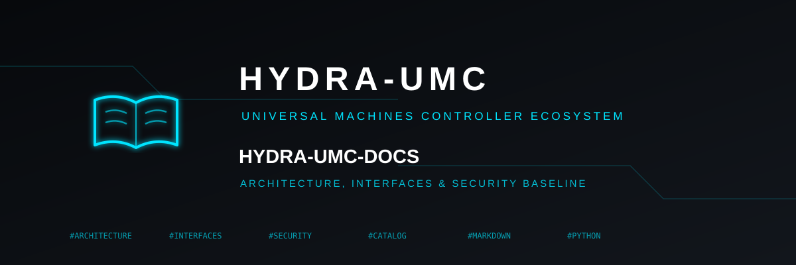
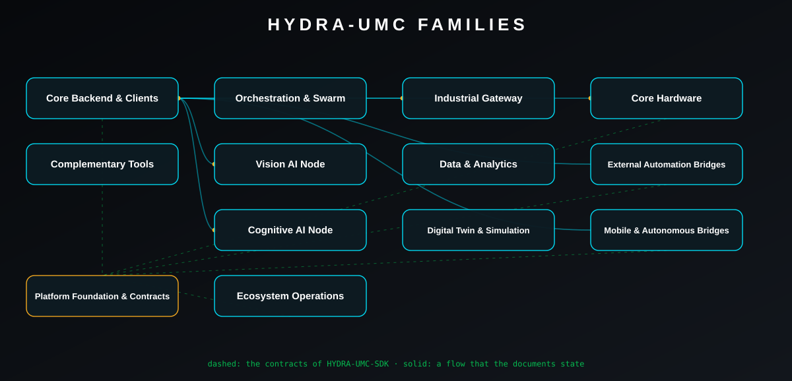
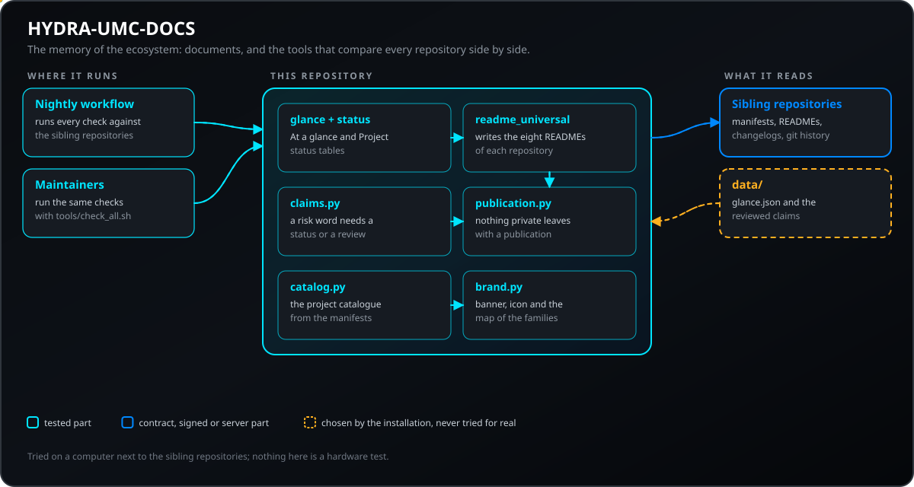
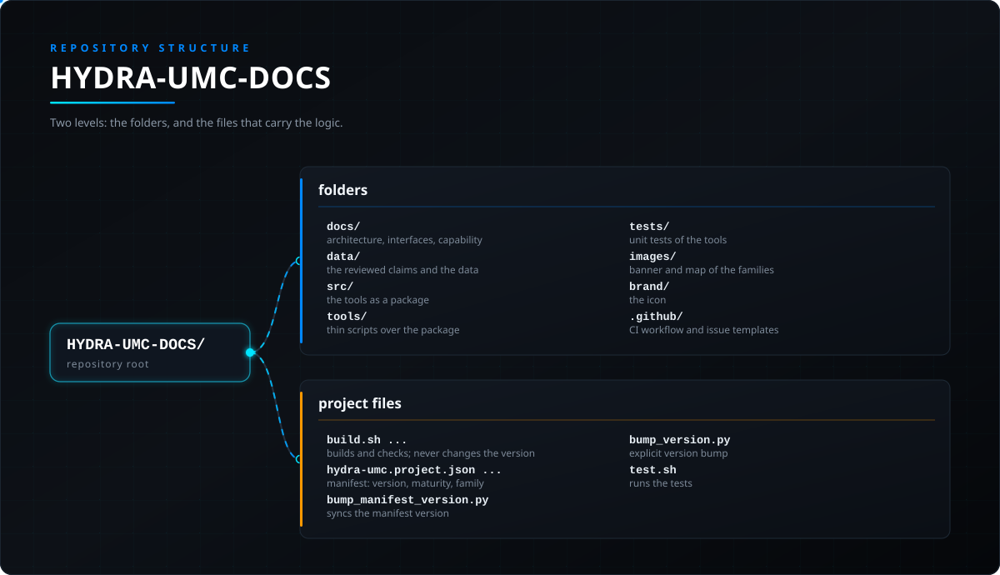

<!-- =============================================================================
HYDRA-UMC-DOCS - Architecture, interfaces, security baseline and what is proven
Copyright (C) JuanenRac (Electro Hobby 3D) <electrohobby3d@gmail.com>
GPL-3.0-or-later - see LICENSE
============================================================================= -->

<p align="center">
  
</p>

# 📚 HYDRA-UMC-DOCS

<p align="center"><a href="README.md">🇺🇸 English</a> | 🇪🇸 <b>Español</b> | <a href="README_fra.md">🇫🇷 Français</a> | <a href="README_ita.md">🇮🇹 Italiano</a> | <a href="README_deu.md">🇩🇪 Deutsch</a> | <a href="README_zho.md">🇨🇳 简体中文</a> | <a href="README_jpn.md">🇯🇵 日本語</a> | <a href="README_por.md">🇵🇹 Português</a></p>

### Arquitectura, interfaces, base de seguridad y la verdad sobre lo que está probado

<p align="center">
  
  
  
  
  
  
</p>

---

**Comprobación de honestidad - qué funciona hoy de verdad:** este repositorio contiene documentos y herramientas pequeñas. Las herramientas (el generador del catálogo, el de la marca, el de los README, la comprobación de publicación y la comprobación de la familia) son reales y tienen pruebas unitarias que se ejecutan en CI; el flujo nocturno las ejecuta contra los demás repositorios de la familia. Los documentos se han escrito a partir de los README, manifiestos, registros de cambios y documentos de esos repositorios tal como se leyeron para esta versión, y una afirmación que no se pudo rastrear hasta un repositorio queda señalada como tal. Nada de esto es una prueba de hardware: la matriz de capacidades dice, para cada capacidad, si solo se simuló, se probó en un ordenador o se ejecutó en hardware real, y el repositorio del firmware indica que todavía no existe ninguna placa montada.

---

> **Estado de seguridad física y de ciberseguridad:** este ecosistema no es un sistema de seguridad certificado. Todavía no existe una ruta de E-STOP por hardware, ni límites ni enclavamientos aplicados por el firmware, ni un comando de movimiento verificado; las imágenes de firmware se comprueban con CRC-32 y una firma Ed25519, y una compilación de versión rechaza las claves de desarrollo publicadas (los cabezales de herramienta y las placas de expansión detrás del relé siguen con cargadores de URTC, que usan un HMAC-SHA256 de clave compartida en lugar de una firma); TLS y TLS mutuo son opcionales y están desactivados por defecto; aún no se ha poblado ni probado ninguna placa propia. Lee la [línea base de seguridad](docs/SECURITY_BASELINE.md) y el [modelo de amenazas](docs/THREAT_MODEL.md) antes de fiarte de cualquier afirmación de aquí para la seguridad de una persona.

---

## 📋 De un vistazo

| | |
|---|---|
| Versión | `0.0.5` |
| Madurez | Andamiaje |
| Tests | 153 (`python -m pytest tests -q`) |
| Tecnología | Markdown / Mermaid / Python / SVG |
| Destino | El PC de quien lo usa |
| En hardware real | No aplica: nada de esto se ejecuta en hardware |

**Ir a:** [Resumen](#-resumen) · [Arquitectura](#-arquitectura) · [Seguridad y protección](#-seguridad-y-protección) · [Inicio rápido](#-inicio-rápido) · [Pruebas](#-pruebas) · [Estructura del repositorio](#-estructura-del-repositorio) · [Proyectos relacionados](#-proyectos-relacionados)

## 🚦 Estado del proyecto

Cada línea es una parte de este repositorio y la luz dice hasta dónde llega hoy. Se escribe con lo que el repositorio puede demostrar (pruebas, compilaciones, ejecuciones), no con lo previsto.

🟢 Hecho y verificado · 🟡 Funciona, con límites conocidos · 🟠 Hecho a medias o sin verificar · 🔴 Sin hacer o sin funcionar

| Área | Estado | Qué significa aquí |
|---|---|---|
| Software | 🟠 | Solo estructura y primeras piezas; falta la mayor parte del trabajo |
| Pruebas | 🟡 | 153 pruebas automáticas, ejecutadas en cada cambio |
| Hardware real | 🟡 | No aplica: nada de esto se ejecuta en hardware |
| Documentación | 🟡 | README en ocho idiomas, comprobado contra el manifiesto en cada cambio |

## 🎯 Resumen

<p align="center">
  
</p>

La imagen siguiente muestra las familias de repositorios y los flujos que afirman sus documentos.

* [Arquitectura](docs/ARCHITECTURE.md): capas, flujos de datos, puertos y fronteras de confianza.
* [Interfaces](docs/INTERFACES.md): quién es dueño de cada contrato y dónde está documentado.
* [Matriz de capacidades](docs/CAPABILITY_MATRIX.md): qué está probado en software y qué necesita hardware, proyecto a proyecto.
* [Base de seguridad](docs/SECURITY_BASELINE.md): lo que el código impone y lo que aún falta; y el [modelo de amenazas](docs/THREAT_MODEL.md).
* [Primer corte vertical](docs/FIRST_VERTICAL_SLICE.md): el camino de extremo a extremo más pequeño que existe hoy.
* [Catálogo de proyectos](docs/PROJECT_CATALOG.md): cada repositorio de la familia, escrito a partir de su propio manifiesto.
* **Herramientas:** `make_catalog.py` escribe el catálogo, `make_brand.py` el banner, el icono y el mapa de familias, `make_readmes.py` los ocho README de este repositorio, `publication_check.py` busca cualquier cosa privada antes de una publicación y `check_all.sh` ejecuta las comprobaciones propias de cada repositorio de la familia e imprime una línea PASS, FAIL o SKIP por cada uno. `make_glance.py` escribe la tabla De un vistazo de cada repositorio a partir de su manifiesto y de `data/glance.json` (`--check` compara, `--apply` escribe); tras subir una versión, `python tools/make_glance.py --apply --repo NOMBRE` actualiza la tabla de ese repositorio. `check_claims.py` lee el README en inglés de cada repositorio de la familia y falla cuando una frase contiene una palabra de riesgo (E-STOP, enclavamiento, tiempo real, firmado, mTLS, FDCAN, YOLO, impulsado por IA, autónomo, certificado, ...) sin una marca de estado a su lado (previsto, no implementado, opcional, desactivado por defecto, simulado, probado, ...), salvo que una persona haya leído esa línea junto al código y la haya anotado en `data/claims_reviewed.json`.

## 🧩 Papel en HYDRA-UMC

HYDRA-UMC-DOCS es la memoria del ecosistema: el lugar donde viven la arquitectura, las interfaces, la base de seguridad y la matriz de capacidades, y donde se guardan las herramientas que comparan todos los repositorios entre sí. Cada repositorio conserva su propio README, sus pruebas y su contrato; este explica cómo encajan y qué se ha probado de verdad.

## 🏛️ Arquitectura

Los documentos describen cada familia del ecosistema. La imagen de abajo es este mismo repositorio: las herramientas leen los manifiestos y los README de los repositorios hermanos y escriben el catálogo, las tablas De un vistazo, el banner y los ocho README, y dos comprobaciones rechazan lo que no debe publicarse.

<p align="center">
  
</p>

## 🔒 Seguridad y protección

| Amenaza | Defensa | Dónde |
|---|---|---|
| Un README que afirma una capacidad de riesgo (una parada de emergencia, un enclavamiento) sin decir hasta dónde está probada | `check_claims.py` lee el README en inglés de cada repositorio y falla ante una frase con una palabra de riesgo que no tiene marca de estado y no fue revisada (`data/claims_reviewed.json`) | `tools/check_claims.py` |
| Algo privado saliendo con una publicación | `publication_check.py` busca cualquier cosa privada en los ficheros y en el historial antes de una publicación | `tools/publication_check.py` |
| Una afirmación que nadie puede rastrear hasta un repositorio | Los documentos se escriben a partir de los README, manifiestos, historiales de cambios y documentos de los repositorios, y una afirmación que no se pudo rastrear se marca como tal | `docs/CAPABILITY_MATRIX.md` |

## 🚀 Inicio rápido

**Requisitos:** Python 3.10 o superior; pytest para las pruebas

```bash
python tools/make_catalog.py --check             # el catálogo está al día (necesita los repositorios junto a este)
python tools/make_brand.py --check               # el banner, el icono y el mapa están al día
python tools/make_readmes.py --check             # los ocho README están al día
python tools/make_glance.py --check              # las tablas De un vistazo de la familia están al día (necesita los repositorios junto a este)
python tools/status_lights.py --check            # las luces de la tabla Estado del proyecto no pasan de lo que permite el manifiesto
python tools/publication_check.py                # nada privado saldría con una publicación
python tools/check_claims.py --require-siblings  # ningún README afirma una capacidad de riesgo sin indicar su estado (necesita los repositorios junto a este)
bash tools/check_all.sh                          # las comprobaciones de cada repositorio, una línea por cada uno
python -m pytest tests -q                        # las pruebas unitarias de las herramientas
```

## 🧪 Pruebas

153 pruebas automáticas se ejecutan con `python -m pytest tests -q`. No necesitan hardware ni nada fuera de esta máquina.

El CI ejecuta `HYDRA_UMC_CI=1 python tools/ci_validate.py`, que comprueba el manifiesto, los documentos, los ocho README y las imágenes.

## 🏗️ Compilación y publicación

`build.sh` / `build.bat` instalan el paquete y ejecutan las pruebas; nunca cambian la versión. `build-test.sh` / `build-test.bat` comprueban sin cambiar nada.

## 📂 Estructura del repositorio

<p align="center">
  
</p>

<details>
<summary>Versión en texto del árbol</summary>

```text
HYDRA-UMC-DOCS/
├── docs/                                                                           arquitectura, interfaces, matriz de capacidades, base de seguridad, modelo de amenazas, primer corte, catálogo generado
├── data/                                                                           las afirmaciones revisadas y los datos de las tablas De un vistazo
├── src/                                                                            las herramientas como paquete (catálogo, marca, README, comprobación de publicación)
├── tools/                                                                          scripts finos sobre el paquete, check_all.sh y las comprobaciones de CI compartidas del ecosistema
├── tests/                                                                          pruebas unitarias de las herramientas
├── images/                                                                         banner y mapa de familias
├── brand/                                                                          el icono
├── .github/                                                                        flujo de CI y plantillas de incidencias
├── build.sh / build.bat / build-test.sh / build-test.bat / run.sh / run.bat        compila y comprueba; nunca cambia la versión
├── hydra-umc.project.json / pyproject.toml / CHANGELOG.md / LICENSE / LICENSE.md   manifiesto: versión, madurez, familia
├── bump_manifest_version.py                                                        sincroniza la versión del manifiesto
├── bump_version.py                                                                 subida de versión explícita
└── test.sh                                                                         ejecuta las pruebas
```

</details>

## 🗺️ Hoja de ruta y límites conocidos

**Límites conocidos hoy**

Este repositorio son documentos y pequeñas herramientas. Las comprobaciones que leen los demás repositorios (el catálogo, las tablas De un vistazo, las afirmaciones) necesitan esos repositorios descargados junto a este. No prueba nada sobre hardware: la matriz de capacidades dice, para cada capacidad, si solo se simuló o se probó de verdad.

## 🌍 Idiomas

Este README y los documentos del repositorio existen en ocho idiomas: inglés, español, alemán, francés, italiano, japonés, chino y portugués (Portugal). Se escriben a la vez y el CI comprueba que los ocho ficheros tengan las mismas secciones y los mismos enlaces. Este repositorio no tiene pantalla ni catálogo de mensajes propios, así que no hay cadenas de interfaz que traducir.

## 🔗 Proyectos relacionados

HYDRA-UMC se compone de repositorios independientes, cada uno con su versión, sus pruebas y su README. Esta es la familia, por grupos:

* **Cognitive AI Node:** [HYDRA-UMC-COGNITIVE-NODE](https://github.com/JuanenRac/HYDRA-UMC-COGNITIVE-NODE), [HYDRA-UMC-DOCS-QA](https://github.com/JuanenRac/HYDRA-UMC-DOCS-QA), [HYDRA-UMC-LOCAL-TECHNICIAN](https://github.com/JuanenRac/HYDRA-UMC-LOCAL-TECHNICIAN), [HYDRA-UMC-SEMANTIC-PLANNER](https://github.com/JuanenRac/HYDRA-UMC-SEMANTIC-PLANNER), [HYDRA-UMC-VLA-ENGINE](https://github.com/JuanenRac/HYDRA-UMC-VLA-ENGINE), [HYDRA-UMC-VOICE-UI](https://github.com/JuanenRac/HYDRA-UMC-VOICE-UI)
* **Complementary Tools:** [HYDRA-UMC-DASHBOARD-AI](https://github.com/JuanenRac/HYDRA-UMC-DASHBOARD-AI), [HYDRA-UMC-TOOL-CLI](https://github.com/JuanenRac/HYDRA-UMC-TOOL-CLI), [HYDRA-UMC-WATCH](https://github.com/JuanenRac/HYDRA-UMC-WATCH)
* **Core Backend & Clients:** [HYDRA-UMC-ANDROID-CONTROL](https://github.com/JuanenRac/HYDRA-UMC-ANDROID-CONTROL), [HYDRA-UMC-DSI](https://github.com/JuanenRac/HYDRA-UMC-DSI), [HYDRA-UMC-EDITOR-STL](https://github.com/JuanenRac/HYDRA-UMC-EDITOR-STL), [HYDRA-UMC-EDITOR-URDF](https://github.com/JuanenRac/HYDRA-UMC-EDITOR-URDF), [HYDRA-UMC-IOS-CONTROL](https://github.com/JuanenRac/HYDRA-UMC-IOS-CONTROL), [HYDRA-UMC-SERVER](https://github.com/JuanenRac/HYDRA-UMC-SERVER), [HYDRA-UMC-STUDIO](https://github.com/JuanenRac/HYDRA-UMC-STUDIO), [HYDRA-UMC-SUITE](https://github.com/JuanenRac/HYDRA-UMC-SUITE)
* **Core Hardware:** [HYDRA-UMC](https://github.com/JuanenRac/HYDRA-UMC)
* **Data & Analytics:** [HYDRA-UMC-ANOMALY-DETECTOR](https://github.com/JuanenRac/HYDRA-UMC-ANOMALY-DETECTOR), [HYDRA-UMC-DATALAKE](https://github.com/JuanenRac/HYDRA-UMC-DATALAKE), [HYDRA-UMC-PRODUCTION-REPORTS](https://github.com/JuanenRac/HYDRA-UMC-PRODUCTION-REPORTS), [HYDRA-UMC-TELEMETRY-COLLECTOR](https://github.com/JuanenRac/HYDRA-UMC-TELEMETRY-COLLECTOR)
* **Digital Twin & Simulation:** [HYDRA-UMC-HIL-BRIDGE](https://github.com/JuanenRac/HYDRA-UMC-HIL-BRIDGE), [HYDRA-UMC-PHYSICS-REPLICA](https://github.com/JuanenRac/HYDRA-UMC-PHYSICS-REPLICA), [HYDRA-UMC-SYNTHETIC-DATA-GEN](https://github.com/JuanenRac/HYDRA-UMC-SYNTHETIC-DATA-GEN), [HYDRA-UMC-TWIN](https://github.com/JuanenRac/HYDRA-UMC-TWIN)
* **Ecosystem Operations:** [HYDRA-UMC-DEV-SERVER](https://github.com/JuanenRac/HYDRA-UMC-DEV-SERVER), **HYDRA-UMC-DOCS** (este repositorio), [HYDRA-UMC-OPS-AGENT](https://github.com/JuanenRac/HYDRA-UMC-OPS-AGENT), [HYDRA-UMC-OS-REBUILDER](https://github.com/JuanenRac/HYDRA-UMC-OS-REBUILDER), [HYDRA-UMC-UPDATER](https://github.com/JuanenRac/HYDRA-UMC-UPDATER)
* **External Automation Bridges:** [HYDRA-UMC-BRIDGE-CNC](https://github.com/JuanenRac/HYDRA-UMC-BRIDGE-CNC), [HYDRA-UMC-BRIDGE-LASER](https://github.com/JuanenRac/HYDRA-UMC-BRIDGE-LASER), [HYDRA-UMC-BRIDGE-OPENPNP](https://github.com/JuanenRac/HYDRA-UMC-BRIDGE-OPENPNP), [HYDRA-UMC-BRIDGE-PRINTER3D](https://github.com/JuanenRac/HYDRA-UMC-BRIDGE-PRINTER3D), [HYDRA-UMC-BRIDGE-ROS2](https://github.com/JuanenRac/HYDRA-UMC-BRIDGE-ROS2)
* **Industrial Gateway:** [HYDRA-UMC-GATEWAY-INDUSTRIAL](https://github.com/JuanenRac/HYDRA-UMC-GATEWAY-INDUSTRIAL), [HYDRA-UMC-MQTT-BROKER](https://github.com/JuanenRac/HYDRA-UMC-MQTT-BROKER), [HYDRA-UMC-MTCONNECT-ADAPTER](https://github.com/JuanenRac/HYDRA-UMC-MTCONNECT-ADAPTER), [HYDRA-UMC-OPCUA-SERVER](https://github.com/JuanenRac/HYDRA-UMC-OPCUA-SERVER)
* **Mobile & Autonomous Bridges:** [HYDRA-UMC-BRIDGE-AMR](https://github.com/JuanenRac/HYDRA-UMC-BRIDGE-AMR), [HYDRA-UMC-BRIDGE-DROIDS](https://github.com/JuanenRac/HYDRA-UMC-BRIDGE-DROIDS), [HYDRA-UMC-BRIDGE-UAV](https://github.com/JuanenRac/HYDRA-UMC-BRIDGE-UAV)
* **Orchestration & Swarm:** [HYDRA-UMC-JOB-DISPATCHER](https://github.com/JuanenRac/HYDRA-UMC-JOB-DISPATCHER), [HYDRA-UMC-NODE-HEALING](https://github.com/JuanenRac/HYDRA-UMC-NODE-HEALING), [HYDRA-UMC-ORCHESTRATOR](https://github.com/JuanenRac/HYDRA-UMC-ORCHESTRATOR), [HYDRA-UMC-PATH-PLANNER-3D](https://github.com/JuanenRac/HYDRA-UMC-PATH-PLANNER-3D), [HYDRA-UMC-SWARM-SYNC](https://github.com/JuanenRac/HYDRA-UMC-SWARM-SYNC)
* **Platform Foundation & Contracts:** [HYDRA-UMC-CONNECTOR-HUB](https://github.com/JuanenRac/HYDRA-UMC-CONNECTOR-HUB), [HYDRA-UMC-OS](https://github.com/JuanenRac/HYDRA-UMC-OS), [HYDRA-UMC-SDK](https://github.com/JuanenRac/HYDRA-UMC-SDK)
* **Vision AI Node:** [HYDRA-UMC-DETECTION-HEF](https://github.com/JuanenRac/HYDRA-UMC-DETECTION-HEF), [HYDRA-UMC-SAFETY-ZONES](https://github.com/JuanenRac/HYDRA-UMC-SAFETY-ZONES), [HYDRA-UMC-VISION-NODE](https://github.com/JuanenRac/HYDRA-UMC-VISION-NODE), [HYDRA-UMC-VISION-STREAMER](https://github.com/JuanenRac/HYDRA-UMC-VISION-STREAMER), [HYDRA-UMC-VISUAL-SERVOING-API](https://github.com/JuanenRac/HYDRA-UMC-VISUAL-SERVOING-API)

**Más allá de HYDRA-UMC:**

* **[ARMOR-DOCS](https://github.com/JuanenRac/ARMOR-DOCS)** - la misma idea para el ecosistema de seguridad A.R.M.O.R.
* **[URTC](https://github.com/JuanenRac/URTC)** - el controlador universal de herramienta de robot, un producto independiente conectado a través del SDK
* **[JuanenRac](https://github.com/JuanenRac/JuanenRac)** - el perfil y el panel de estado de todos los ecosistemas

## 📚 Documentación

Dónde leer más:

* [Matriz de capacidades: qué está probado y qué no](docs/CAPABILITY_MATRIX.md)
* [Catálogo de proyectos: versiones y tipos de los repositorios](docs/PROJECT_CATALOG.md)
* [Base de seguridad del ecosistema](https://github.com/JuanenRac/HYDRA-UMC-DOCS/blob/main/docs/SECURITY_BASELINE.md)
* [Modelo de amenazas del ecosistema](https://github.com/JuanenRac/HYDRA-UMC-DOCS/blob/main/docs/THREAT_MODEL.md)
* [Historial de cambios de este repositorio](CHANGELOG.md)
* [Licencia de este repositorio](LICENSE.md)

## 🤝 Contribuir y comunidad

* Antes de un pull request ejecuta `HYDRA_UMC_CI=1 py -3 tools/ci_validate.py` (o `HYDRA_UMC_CI=1 python3 tools/ci_validate.py`): debe imprimir `CI_VALIDATION=PASS`. No ejecutes `build.sh` ni `build.bat` para esta comprobación; compilar no es comprobar.
* Los ocho README se escriben desde una sola fuente en HYDRA-UMC-DOCS; no los edites a mano. Cambia la fuente y vuelve a escribirlos con `tools/make_readmes.py`.
* No afirmes en un README lo que no se ha ejecutado: di «simulado» o «sin probar en hardware» cuando esa sea la verdad.
* Mira [CONTRIBUTING.md](CONTRIBUTING.md), el [código de conducta](CODE_OF_CONDUCT.md), [SECURITY.md](SECURITY.md) y [SUPPORT.md](SUPPORT.md).

## 👤 AUTOR

**JuanenRac (Electro Hobby 3D)** · electrohobby3d@gmail.com

## 📜 LICENCIA

GPL-3.0-or-later - [LICENSE](LICENSE).
