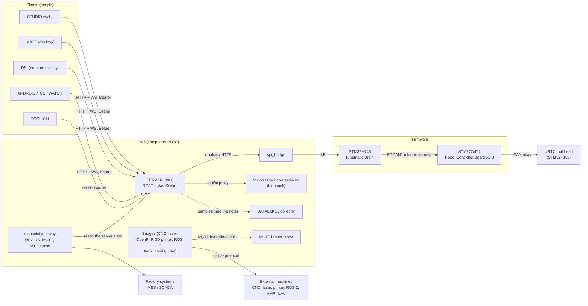

<!--
=============================================================================
HYDRA-UMC-DOCS - Architecture of the HYDRA-UMC ecosystem
Copyright (C) 2026 JuanenRac (Electro Hobby 3D) <electrohobby3d@gmail.com>
CC BY-SA 4.0 - see LICENSE.md
=============================================================================
-->

# HYDRA-UMC architecture

How the repositories of HYDRA-UMC fit together: the layers, the data flows, the ports and the places where one piece stops trusting another. It is written from the READMEs, manifests, changelogs and documents of the repositories (the sources are named in each section), not from running the system. Where a repository says that something is planned, or has never run on hardware, this page says so too.

**Reading rule.** The words of the repositories are used as they are: *real* means the code exists and has tests; it does not mean that it has run on a machine. The [capability matrix](CAPABILITY_MATRIX.md) says, per project, how far each capability has been proven.

## The layers

| Layer | Repositories | What it does |
|---|---|---|
| Firmware | HYDRA-UMC | Motion-control firmware for the motherboard: an STM32H745 (Cortex-M7 at 480 MHz and Cortex-M4 at 240 MHz, one FreeRTOS instance per core) as the Kinematic Brain, STM32G474 Robot Controller Boards, bootloaders with CAN-OTA / SPI-OTA, and the CM5-side SPI bridge. |
| Tool heads | URTC (outside this family) | The tool-head firmware (STM32F303) reached through the Robot Controller Board. |
| Platform | HYDRA-UMC-OS, HYDRA-UMC-SDK, HYDRA-UMC-CONNECTOR-HUB | The product layer on Raspberry Pi OS for the CM5 (read-only device agent, preflight, rollback, Wi-Fi provisioning); the versioned contracts, conformance fixtures and shared CI checks; the registry of external-machine adapter manifests. |
| Backend | HYDRA-UMC-SERVER | The one headless backend that every control client talks to: REST and WebSocket on port 3000, authentication, mDNS discovery, ownership of robots, the global stop. |
| Clients | HYDRA-UMC-STUDIO, -SUITE, -DSI, -ANDROID-CONTROL, -IOS-CONTROL, -WATCH, -EDITOR-URDF, -EDITOR-STL, -TOOL-CLI | Web, desktop, onboard touch display, phones, watch and command line. All of them are clients of the server's API. |
| Bridges | HYDRA-UMC-BRIDGE-CNC, -LASER, -OPENPNP, -PRINTER3D, -ROS2, -AMR, -DROIDS, -UAV | Coordination boundaries to machines that keep their own controller. Every job goes through the safety gate of the SDK. |
| Industrial gateway | HYDRA-UMC-GATEWAY-INDUSTRIAL, -OPCUA-SERVER, -MQTT-BROKER, -MTCONNECT-ADAPTER | The robot state exposed to factory systems in OPC UA, MQTT and MTConnect. |
| Orchestration | HYDRA-UMC-ORCHESTRATOR, -JOB-DISPATCHER, -NODE-HEALING, -PATH-PLANNER-3D, -SWARM-SYNC | Missions, a priority job queue, a health watchdog with recovery requests, a 3D path planner, CRDT state synchronisation. |
| Vision AI | HYDRA-UMC-VISION-NODE, -VISION-STREAMER, -DETECTION-HEF, -SAFETY-ZONES, -VISUAL-SERVOING-API | Camera relay, model registry, zone checking and a servoing correction law. Real Hailo-8 inference is not part of what has run. |
| Cognitive AI | HYDRA-UMC-COGNITIVE-NODE, -VLA-ENGINE, -VOICE-UI, -SEMANTIC-PLANNER, -DOCS-QA, -LOCAL-TECHNICIAN | Voice front end, rule-based planning and recovery, lexical document search, a read-only diagnostic assistant. No language model runs in these repositories today. |
| Data | HYDRA-UMC-DATALAKE, -TELEMETRY-COLLECTOR, -ANOMALY-DETECTOR, -PRODUCTION-REPORTS, -DASHBOARD-AI | A SQLite time-series store, ingestion, statistical anomaly detection, OEE reports and text summaries. |
| Twin and simulation | HYDRA-UMC-TWIN, -HIL-BRIDGE, -PHYSICS-REPLICA, -SYNTHETIC-DATA-GEN | Readiness hub, a hardware-in-the-loop interlock, forward kinematics, synthetic images. |
| Operations | HYDRA-UMC-UPDATER, -OS-REBUILDER, -OPS-AGENT, -DEV-SERVER, HYDRA-UMC-DOCS | Install and update from manifests, a CM5 image builder, an incident coordinator, a development host and this documentation hub. |

Sources: the `family`, `role` and `parent` of each `hydra-umc.project.json`; the README of each repository; `HYDRA-UMC/docs/architecture.md`. The full list, generated from the manifests, is the [project catalogue](PROJECT_CATALOG.md).

## Diagram

The dotted line is the least certain one: one passage of the collector README says that it polls the server, another that it only receives what producers push to it and polls nothing, so the repositories do not settle which process carries the samples (see the [interfaces](INTERFACES.md)).

## Data flows

1. **Operator to robot.** A client signs in (`POST /api/login`), keeps the Bearer token, reads the full settings tree with `GET /api/settings` and receives `settings` snapshots and `delta` updates on the `/ws` WebSocket. Commands go to `POST /api/robot/:id/command`; the server arbitrates who owns a robot. Source: `HYDRA-UMC-SERVER/docs/REMOTE_API.md`.
2. **Server to firmware.** The server relays flashing to a local `spi_bridge` service (administrators only, progress over the WebSocket). The bridge speaks SPI to the STM32H745; the H745's Cortex-M4 runs the FDCAN1 master ("STACK A", up to eight slots) and the Robot Controller Boards relay frames to the tool head. This path is code that compiles and is tested against fakes: no populated board exists yet (`HYDRA-UMC/README.md`, `docs/architecture.md`).
3. **Global stop.** `POST /api/stop-all` stops every robot and switches every valve and pump off through the server, whatever a reservation says. It is a server function; the firmware repository states that it contains no E-STOP path yet. The two are different things, see the [security baseline](SECURITY_BASELINE.md).
4. **Server to AI services.** `/api/ai/:service/*` is an authenticated pass-through to the local services of the vision and cognitive families (cognitive-node, detection-hef, visual-servoing-api, vla-engine), all documented as loopback systemd units. Voice turns go to the loopback `HYDRA-UMC-VOICE-UI` gateway; the server keeps the gateway token and the voice service cannot actuate a robot by itself.
5. **Bridges to machines.** A bridge accepts a `BridgeJob` on `hydra/bridges/<name>/cmd/job` over MQTT (or through its Python API), runs it through `evaluate_job()` of the SDK and answers on `.../cmd/job/result`. The state of the cell and the observed state of the external machine decide the answer. A bridge cannot send raw CAN or SPI frames and cannot override the E-STOP of the MCU (`HYDRA-UMC-SDK/docs/BRIDGE_CONTRACT.md`).
6. **Server state to factory systems.** The gateway children translate the server's state into an OPC UA address space (port 4840), MTConnect `/probe` and `/current` (port 5000) and MQTT topics. The `hydra/swarm/...` topics are, according to the MQTT broker README, the intended future shape: only the `hydra/bridges/<name>/...` topics are real and wired today.
7. **Telemetry.** The collector turns CAN frames and WebSocket JSON into samples and writes them to DATALAKE (`POST /ingest`); the anomaly detector, the reports and the summaries read DATALAKE over HTTP.
8. **Updates.** Software: HYDRA-UMC-UPDATER discovers repositories from their manifests on GitHub and installs or updates by clone, stage, verify and promote. Firmware: the bootloaders verify a CRC32 and an HMAC-SHA256 into a backup slot before copying (see the [security baseline](SECURITY_BASELINE.md) for what that does not cover).
9. **Discovery.** `GET /api/hydra-info` answers a subnet scan and the server advertises `_hydra._tcp` over mDNS. A client sends `X-Hydra-Client` (`suite`, `android` or `ios`) and an administrator can make the server invisible to discovery for one client type.

## Ports

The defaults written in the READMEs, manifests (`service.port`) and systemd units of the repositories. A port in this table is not a statement that the service is running anywhere.

| Service | Port | Bind and notes |
|---|---|---|
| HYDRA-UMC-SERVER | 3000 | REST, WebSocket and, when built, the web client; HTTPS/WSS when `TLS_CERT_PATH` and `TLS_KEY_PATH` are set |
| HYDRA-UMC-MQTT-BROKER | 1883, 8083, 8883 | MQTT over TCP; MQTT over WebSocket on 8083 (opt-in); MQTT over TLS on 8883 (opt-in); a secure WebSocket port by `MQTT_WSS_PORT` |
| HYDRA-UMC-OPCUA-SERVER | 4840 | OPC UA |
| HYDRA-UMC-MTCONNECT-ADAPTER | 5000 | MTConnect |
| HYDRA-UMC-GATEWAY-INDUSTRIAL | 8000 | `GET /health`, `GET /status`, `POST /command` |
| HYDRA-UMC-JOB-DISPATCHER | 8090 | HTTP API, `GET /health` |
| HYDRA-UMC-VOICE-UI | 8091 | loopback; a non-loopback bind needs a token |
| HYDRA-UMC-TELEMETRY-COLLECTOR | 8092 | loopback by default; a network bind needs a bearer token |
| HYDRA-UMC-DETECTION-HEF | 8093 | model registry API |
| HYDRA-UMC-VISION-NODE | 8094 | readiness and frame validation |
| HYDRA-UMC-DATALAKE | 8095 | `/ingest`, `/query`, `/aggregate`, `/stats` |
| HYDRA-UMC-COGNITIVE-NODE | 8096 | readiness |
| HYDRA-UMC-ANOMALY-DETECTOR | 8097 | `/stats` |
| HYDRA-UMC-VLA-ENGINE | 8098 | tokens, trajectory, status |
| HYDRA-UMC-PRODUCTION-REPORTS | 8099 | `/reports/...` |
| HYDRA-UMC-VISION-STREAMER | 8100, 8554 | `stream serve` MJPEG (the README example uses 8100); RTSP paths of the MediaMTX configuration on 8554 |
| HYDRA-UMC-SAFETY-ZONES | 8108 | zone checks |
| HYDRA-UMC-SEMANTIC-PLANNER | 8109 | planning |
| HYDRA-UMC-DOCS-QA | 8110 | `GET /query`, `GET /stats` |
| HYDRA-UMC-TWIN | 8111 | readiness |
| HYDRA-UMC-SWARM-SYNC | 8112 | `POST /reconcile`, `GET /state`, `GET /stats` |
| HYDRA-UMC-HIL-BRIDGE | 8113 | routing |
| HYDRA-UMC-ORCHESTRATOR | 8114 | missions |
| HYDRA-UMC-VISUAL-SERVOING-API | 8116 | correction and authorisation |

## Trust boundaries

* **People to the server.** Everything a person does passes through the server's authentication: a JWT access token (30 days by default, shortened by `JWT_EXPIRES_IN`), a rotating opaque refresh token (90 days by default), two roles (`admin`, `operator`). Clients are not privileged services; a crashed dashboard is not a safety fault, a failed MCU handshake is (`HYDRA-UMC-OS/docs/SERVICE_MODEL.md`).
* **The server to the machines.** Only the server's spi_bridge path reaches the firmware. Bridges reach other machines, never the MCU, and every job crosses the SDK gate. The MCU is documented as the final physical safety authority, but the firmware does not implement the E-STOP yet.
* **The broker.** A production start of the broker refuses to run without authentication and per-client topic ACLs. A message on a bridge topic is a claim: the gate uses the machine state that the bridge itself observes, not the one inside the message, and ignores retained messages as requests.
* **AI services.** They recommend and calculate; they do not hold the right to actuate. Voice needs a signed, single-use confirmation for an intent, and a retrieved document can never trigger a tool call in the maintenance assistant.
* **Updates.** An installer runs the build-test script that the candidate itself brings; an optional gate (`HYDRA_UMC_UPDATER_REQUIRE_SIGNED=1`) verifies the signature of the commit first.
* **Secrets.** Created on the CM5 under `/etc/hydra-umc/` with restrictive permissions, never copied from Git; every service runs as its own non-login account.

## What this page does not claim

* That any service listed here runs together on one machine: the compose files and the full topology have not been exercised as one stack (the cognitive and orchestration READMEs say so).
* That CAN FD is in use: the silicon and the transceivers support it, the protocols documented today use classic frames with at most eight bytes.
* That MQTT carries the state of the robots: today it carries the bridge topics.
